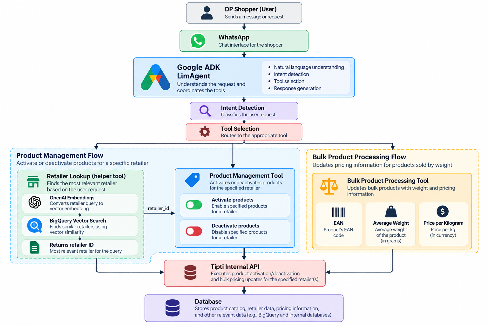

# Tipti Shopper AI Agent

## Overview

This project is a portfolio adaptation of an AI Agent designed to help Tipti Shoppers with operational tasks. It allows them to activate and deactivate products, as well as process bulk prices.It does so using Google ADK, which collects the user's required information and uses custom tools access the company's private API and modify it's database.

## Problem

When completing an order, Tipti Shoppers must look for the products requested in a physical supermarket, ran by third-party companies. This can be problematic for users and Shoppers due to the inconsistency with stock updates and bulk prices. In the past, Tipti Shoppers had to contact the Tipti Care Team through WhatsApp whenever a product was out of stock or not to be found at all, to request the product to be deactivated. The same happened whenever a bulk price product wasn't properly updated. This hefty process cause a lot of delays in their workflow and created an unnecessary burden on the Tipti Care Team, creating a loophole of inefficiency that deeply affected Tipti's operational performance.

## Solution

The agent uses Google ADK's tool-calling capabilities to determine user intent, collect missing information, resolve retailer identifiers, and execute internal APIs. It can be accessed through WhatsApp and it handles the operational burden that the Tipti Care Team was tasked with in the past. The Agent first identifies the Shopper's intent (activating/deactivating/bulk processing) in a conversational manner. It then identifies the retailer from where the request is being sent, by using a dedicated lookup tool with embeddings and BigQuery. It finally connects to Tipti's internal API and directly modifies the database. This takes the Tipti Care Team out of the workflow, allowing them to focus on their main role (customer service) and overall boosting operational efficiency.

## System Architecture

## Tech Stack

### Languages

- Python

### AI

- Google ADK
- OpenAI API
- Vertex AI

### Cloud

- Google Cloud
- BigQuery

### Tools

- dotenv

## Interesting Technical Challenges

### Prompt Engineering

Making the prompt for the Agent was quite challenging due to repeated inconsistencies and hallucinations. Since I neede my agent to handle input and output to use the custom tools, precision with format was a must. This required building a dedicated structure and a fixed, clear, strict workflow. After looking at examples online, consulting other LLM's, and analyzing every edge case I could think of, I managed to build a prompt that gave me consistent results in format and content. To me, this was the most rewarding part of this project, as the prompting techniques I developed have continued to be useful in my daily life as someone in constant contact with AI tools.

### Tool Chaining

The biggest challenge here was accounting for user inconsistencies in format. Tipti's API required a retailer_id to change anything about a product, as stock and conditions vary per retailer. However, a Shopper is not expected to know the retailer_id of where they're working, so I had to work around the inconsistencies of how the name of the reailer would be written by them (typos, misspellings). To solve this I built a lookup tool that used OpenAI's Embeddings API to convert the user's retailer name into a vector embedding. This embedding was then compared against retailer embeddings stored in BigQuery using cosine similarity to retrieve the closest matching retailer_id, making the workflow robust to typos and misspellings.

### Structured Configuration

To prepare this project for public release, I removed hardcoded credentials and centralized configuration using environment variables and a dedicated settings.py module. This makes the project portable while keeping sensitive information outside the repository.

### Confidentiality Notice

This repository is a portfolio adaptation of a production project developed during my internship at Tipti. Company credentials, datasets, API endpoints, and proprietary business logic have been removed or generalized. The repository focuses on demonstrating the system architecture, prompt engineering, and software design rather than serving as a deployable production system.
